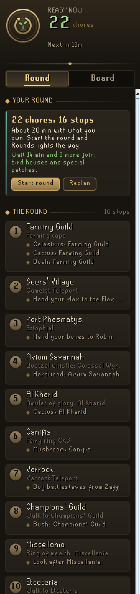
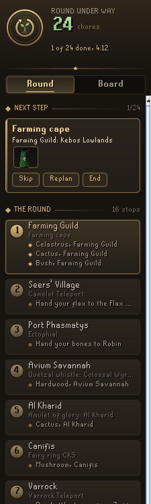
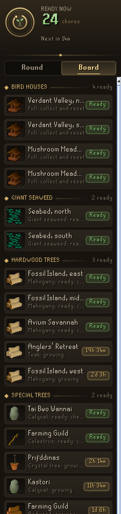
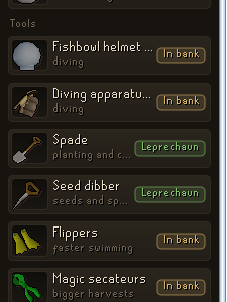
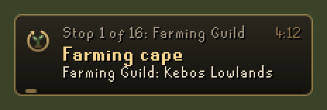

# Codex Rounds

**Your whole farm run and every timed chore around it, in one guided round.** Herbs, trees and fruit trees, birdhouses, giant seaweed, hardwood, calquat, celastrus, redwood and crystal trees, spirit trees, cactus, bushes, mushrooms, belladonna, anima and Hespori, Sailing's coral nurseries, the diary dailies, the weekly Tears of Guthix and the Kingdom of Miscellania. Codex Rounds shows what is ready, plans the fastest way round with the teleports you own, lists what to bring, and points at the next click at every stop.

It is part of the **Codex** suite, after [Codex Navigator](https://github.com/Nubles/OSRS-Codex-Navigator), [Codex Guardian](https://github.com/Nubles/OSRS-Codex-Guardian), [Codex Log Insight](https://github.com/Nubles/OSRS-Codex-Log-Insight), [Codex Gear Roadmap](https://github.com/Nubles/OSRS-Codex-Gear-Roadmap), [Codex Session Chronicle](https://github.com/Nubles/OSRS-Codex-Session-Chronicle), [Codex Ledger](https://github.com/Nubles/OSRS-Codex-Ledger) and [Codex Quartermaster](https://github.com/Nubles/OSRS-Codex-Quartermaster), and shares their look: warm ink, aged gold and the game's own fonts.

<p align="center">
  
  
  
</p>

## What it does

- **Board.** Every chore in one list, grouped as herbs, trees, fruit trees, bird houses, giant seaweed, hardwood trees, special trees, spirit trees, special patches, dailies and the kingdom. Each row says what is waiting (full and ready to collect, ready for its health check, diseased, dead, growing) and a countdown to when it will be ready. Patches you have not unlocked say what they need, and patches you have not visited yet say so instead of guessing.
- **The round.** Press **Start** and the ready chores (plus anything due within the next ten minutes, adjustable) become an ordered list of stops. The order comes from the teleports you actually own: jewellery, capes, diaries' items, spellbook teleports for your book and level, fairy rings if you can use them, and only the ones whose quest or unlock you have finished, and short walks where a walk beats a teleport (Miscellania to Etceteria, Varrock to the Champions' Guild, the Fossil Island houses to the seabed). It starts with the nearest next stop and is then improved until no swap or reversal saves time.
- **What to bring.** One pull list for the whole round: teleports, tools (spade, dibber, secateurs, diving gear), seeds and saplings for what you will replant, compost, gardener payments, logs and hop seeds for the bird houses, flax and bones for the dailies and coins for the kingdom. Each row is marked as packed, in your bank, optional or short (or to buy, for seeds and payments on a main), so you see what is missing before you leave. A hammer, chisel, Imcando hammer or jeweller's chisel all count, and when the round needs more than a full pack, Rounds splits it into trips: each trip has its own pull list, and the guide sends you to the bank before the next one. Gardener payments can be brought noted. Ironmen are only sent to plant seeds and saplings they own. Each special tree (calquat, celastrus, redwood, crystal) can be turned off on its own, any patch can be left out by name in the Leave out box (for example "Lletya, Catherby herbs"), you pick the herb, tree and fruit tree to plant or let Rounds choose the best you can, and on Fossil Island the bird houses go Verdant Valley first, then Mushroom Meadow, with a nudge to take the Magic Mushtree.
- **Tool Leprechaun aware.** Tools and compost stored with the tool leprechaun are read from the game, so when the round starts at a stop with a leprechaun (the Farming Guild, Fossil Island, the seabed, Prifddinas and most patch sites in between) they are marked as waiting there instead of asked for from the bank, and the first step at that stop is to take them out.
- **Round bank tab.** When you bank for a round, the bank opens on a tab holding exactly the pull list, one row for each kind of supply in the order of the list, so withdrawing is one sweep. **Lay it out in my bank** under the pull list does the same on demand. The tab uses RuneLite's Bank Tags plugin.
- **Next step.** At every moment the panel and a small plaque in the game view say the one thing to do next: the teleport to use, the patch to check, the house to rebuild, the advisor to pay. The target is outlined in the world, a hint arrow points at it, the item to use is highlighted in your inventory and bank, and a marker sits on the world map. Steps tick themselves off as the game confirms them, and **Skip** moves past anything you want to leave.
- **Replanting.** For each patch type it picks the best seed you own that your Farming level allows (or the one you set), and reminds you to compost and pay the gardener if you want that.
- **Coral nurseries.** Sailing's two coral patches beneath the Great Conch join the round once Troubled Tortugans is done (before that the board says what they need). Coral grows in four 40 minute stages and is read from the same game values as Time Tracking. The round takes you by fairy ring CJQ (or the rowboat from The Summer Shore) to the eastern coast and down the steps at the end of the dock, asks for a medallion of the deep or the fishbowl helmet and diving apparatus, never for flippers, compost or a dibber, plants the best frag you own (elkhorn, pillar or umbral), and pays Chet in the coral below it if you protect your crops.
- **Diary dailies.** Zaff's battlestaves, Cromperty's noted essence, the Flax keeper, Rantz's arrows, Robin's bone exchange, Thirus's runes, Bert's sand, the Nightmare Zone herb boxes and Lundail's runes, each with the amount your diary tier gives and whether you have claimed it today. The day resets at midnight UTC, as in the game.
- **Tears of Guthix.** Juna's weekly visit joins the round when she will let you in: from 00:00 UTC seven days after your last visit, and only once you have gained a quest point or 100,000 xp since (the wiki's rules). The board counts down to her day, or says how much xp is still to go, and names the skill the tears would train: your lowest, with the wiki's tie order, leaving out Runecraft, Herblore, Construction and Sailing until you can train them. The round takes you there by games necklace (or through the Lumbridge Swamp Caves) and points at Juna. The game keeps no value for "eligible this week", so Rounds learns the week from the visits it sees and from Juna's own words when she turns you away; until then the board says it has not seen it yet.
- **Sulliuscep runs.** In Fossil Island's Tar Swamp, Rounds asks the game which of the six sulliusceps is grown (each one's placement shows the grown cap or a sprout by your own player variable), so the cap to cut next is named in the panel and on the plaque, with how far away it is and the one after it. A trail of six seals shows which fell this run. The run is timed from the first chop to the sixth fall against a ghost of your fastest lap, the mushrooms, mort myre fungi, sulliuscep caps, numulites and fossils that came into your pack are counted, and the board keeps Woodcutting xp an hour from your own last runs. The order the caps grow in is learned from your first whole lap; until then the game's own numbering stands in and the next cap is marked as expected. Nothing is drawn on the caps themselves.
- **Farming contracts.** Guildmaster Jane's contract joins the round when it is done (hand it in and take the next) or when none is running. If the contract crop grows in a guild patch Rounds tends (a bush, cactus, celastrus or redwood), that patch is planted with it.
- **Quick loop.** When bird houses or seaweed are ready, **Quick loop** runs just those: the hourly Fossil Island trip, with the same guidance.
- **Kingdom of Miscellania.** Your coffer and approval estimated day by day from when you last checked, with the coffer you should top up to for a full payout and how many days until approval drops below your target. The kingdom joins the round when it needs a visit.
- **Learns your pace.** Every teleport leg is timed from the moment the guide says to travel to the moment you stand in the stop. After two laps a leg is planned with your own time instead of the estimate, so the order fits how you actually play. Detours, like a stop at the bank, are left out.
- **Worth the wait?** When a short wait brings several more chores in, the round card says so: "Wait 14 min and 3 more join: bird houses and special patches."
- **Round history.** When a round ends, a line in the chat box sums it up (chores done, time taken) and the panel keeps your best time.
- **Ready alert.** Optionally, a notification when enough chores are ready to make a round worth it (four by default).

<p align="center">
  
  
</p>

## How it reads your chores

Patch states come from the same game values RuneLite's Time Tracking plugin uses, read whenever you are near a patch. Growth times are predicted the same way, including your farming tick offset, so the board keeps counting while you are elsewhere. If Time Tracking or Kingdom of Miscellania have already seen a patch or your kingdom, Codex Rounds starts from what they saw, without changing their data. Bird houses are read from their own values as soon as you are on Fossil Island. Your bank is remembered from the last time it was open, so the pull list works anywhere.

## Rules posture

Codex Rounds only reads what the game already shows you and draws highlights, like the farming and time tracking plugins do. It does not click, change menus, or send anything over the network.

## Field notes

An optional setting, **Keep field notes** (under Field notes, off by default), writes a plain record of what Rounds reads and decides to its own folder in `.runelite/plugin-data` on your computer, one line at a time. It is for checking the plugin's guesses against real play: when something looks wrong, the notes show what it saw and why it chose what it did. Other players' chat is never written down, it stays on your computer, and nothing is sent anywhere.

## Development

```bash
./gradlew build   # compile and run tests
./gradlew run     # launch RuneLite with the plugin loaded
```

The board, route planner and step guide (`core/`) are plain Java with unit tests; the panel and overlays are in `ui/` and `overlay/`.

## Licence

BSD 2-Clause, see [LICENSE](LICENSE).
